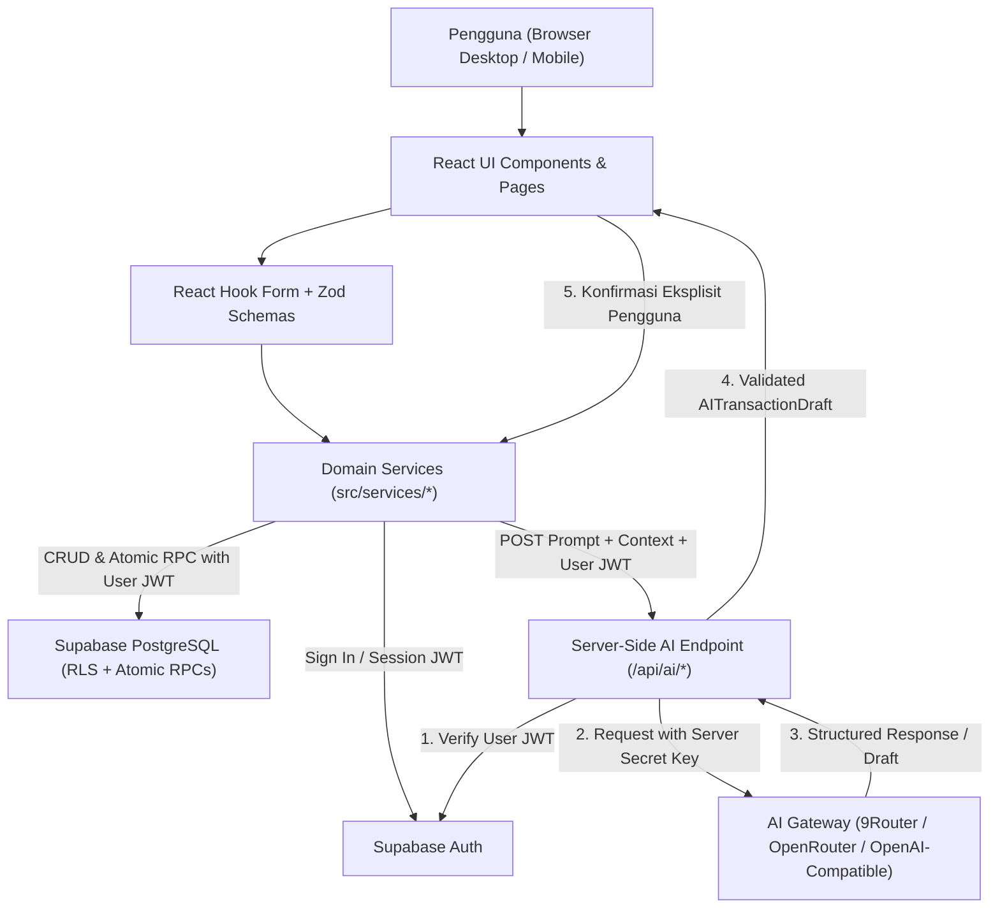

# ARCHITECTURE.md — Technical Architecture & System Design: Finora AI

- **Status Arsitektur**: `IMPLEMENTED (Milestone 1–4 Baseline)` — Fondasi aplikasi, sistem desain Minimalist Premium Fintech, routing shell, migrasi Supabase 11 tabel + RLS + trigger atomik (`0001`–`0005`), autentikasi pengguna, modul buku besar transaksi, rekening/dompet, kategori, modul perencanaan keuangan (Anggaran, Target Tabungan, Utang/Piutang, Tagihan/Transaksi Berulang), dan dashboard produksi telah terimplementasi dan terverifikasi dengan 32/32 tests. Modul Laporan Analitik (M5) dan AI Financial Assistant (M6) berstatus `PLANNED`.
- **Pembaruan Terakhir**: 2026-10-26

---

## 1. Tech Stack & Architectural Overview

Finora AI dirancang sebagai aplikasi web modern dengan pemisahan tegas antara **Client Application (SPA)**, **Database & Auth Layer (Supabase PostgreSQL + RLS)**, dan **Server-Side AI Gateway Layer (Serverless/Edge API)**.

| Layer | Teknologi yang Disepakati | Peran Utama |
| :--- | :--- | :--- |
| **Frontend Framework** | React + TypeScript (`strict: true`) + Vite | SPA reaktif dengan tipe statis ketat dan bundling cepat. |
| **Styling & Design System** | Tailwind CSS + `shadcn/ui` (seperlunya) + Lucide React | Implementasi estetika *Minimalist Premium Fintech* (`#F7F7F2`, `#176B52`, `#222824`, `#DDECE4`), responsif, dan mendukung Light/Dark mode. |
| **Routing** | React Router | Navigasi deklaratif, protected routes, dan layout bersarang (Desktop Sidebar / Mobile Bottom Nav). |
| **Form & Validation** | React Hook Form + Zod | Pengelolaan form berperforma tinggi dan validasi skema tunggal untuk UI, API, serta output AI. |
| **Data Visualization** | Recharts | Grafik tren arus kas, komposisi kategori pengeluaran, dan progres anggaran. |
| **Auth & Database** | Supabase Auth + Supabase PostgreSQL + Row Level Security (RLS) | Autentikasi pengguna, penyimpanan relasional ACID, fungsi RPC atomik, dan isolasi data per pengguna di level baris database. |
| **AI Integration Layer** | Server-Side AI Provider Abstraction (Vercel Serverless/Edge Functions atau Supabase Edge Functions) | Menyembunyikan secret API key, memverifikasi JWT pengguna, membangun prompt kontekstual, dan memanggil provider OpenAI-compatible (9Router / OpenRouter / lainnya). |
| **Deployment Target** | Vercel (jika sesuai) + Supabase Cloud | Hosting aset statis frontend dan eksekusi fungsi API server-side. |

---

## 2. Folder Structure: Implemented vs Planned

Struktur direktori aktual di repositori saat ini menandai apa yang telah diimplementasikan pada **Milestone 1** (`[IMPLEMENTED]`) dan rencana modul berikutnya (`[PLANNED]`):

```text
finora-ai/
├── AGENTS.md                        # [IMPLEMENTED] Instruksi permanen untuk seluruh AI coding agent
├── PRD.md                           # [IMPLEMENTED] Spesifikasi produk, aturan bisnis, dan roadmap
├── ARCHITECTURE.md                  # [IMPLEMENTED] Dokumen arsitektur teknis ini
├── HANDOFF.md                       # [IMPLEMENTED] Status aktual proyek dan log serah-terima antar-agent
├── package.json                     # [IMPLEMENTED] Konfigurasi paket & skrip (dev, build, lint, test)
├── tsconfig.json                    # [IMPLEMENTED] Root tsconfig dengan strict: true
├── tsconfig.app.json                # [IMPLEMENTED] Compiler options untuk src/ dan tests/
├── tsconfig.node.json               # [IMPLEMENTED] Compiler options untuk vite.config.ts
├── vite.config.ts                   # [IMPLEMENTED] Vite bundler dengan chunk splitting vendor
├── postcss.config.js                # [IMPLEMENTED] PostCSS Tailwind CSS + Autoprefixer
├── tailwind.config.js               # [IMPLEMENTED] Token warna Minimalist Premium Fintech
├── eslint.config.js                 # [IMPLEMENTED] ESLint 9 + TypeScript ESLint strict rules
├── .env.example                     # [IMPLEMENTED] Template variabel environment tanpa secret
├── .gitignore                       # [IMPLEMENTED] File abaikan Git
├── index.html                       # [IMPLEMENTED] Entry point HTML dengan font Inter/Geist
├── api/                             # [PLANNED - M6] Server-side endpoints (Vercel Serverless/Edge)
│   └── ai/
│       ├── _provider.ts             # [PLANNED - M6] Abstraksi AI gateway (OpenAI-compatible)
│       ├── _auth.ts                 # [PLANNED - M6] Verifikasi JWT Supabase
│       ├── chat.ts                  # [PLANNED - M6] Endpoint POST /api/ai/chat
│       └── draft-transaction.ts     # [PLANNED - M6] Endpoint POST /api/ai/draft-transaction
├── supabase/                        # [IMPLEMENTED - M2/M3/M4] Konfigurasi database & migrasi SQL
│   ├── migrations/
│   │   ├── 0001_initial_schema.sql  # [IMPLEMENTED] 10 tabel BIGINT, composite FK & index
│   │   ├── 0002_rls_policies.sql    # [IMPLEMENTED] RLS policies ketat (auth.uid() = user_id)
│   │   ├── 0003_triggers_and_onboarding.sql # [IMPLEMENTED] Trigger owner enforcement, saldo atomik & onboarding
│   │   ├── 0004_ledger_atomic_rpcs.sql # [IMPLEMENTED] Trigger sync initial_balance & RPC recalculate_account_balance
│   │   └── 0005_planning_enhancements.sql # [IMPLEMENTED - M4] Budgets nullable category, savings_contributions, debt sync triggers
│   └── seed.sql                     # [IMPLEMENTED] Skrip seed aman tanpa akun demo publik
├── src/                             # [IMPLEMENTED - M1–M4] Source code aplikasi frontend
│   ├── main.tsx                     # [IMPLEMENTED] Entry point React 19
│   ├── App.tsx                      # [IMPLEMENTED] Root providers, AuthProvider, ProtectedRoute, Router
│   ├── index.css                    # [IMPLEMENTED] Variabel CSS tema Light/Dark & tabular-nums
│   ├── vite-env.d.ts                # [IMPLEMENTED] TypeScript environment types
│   ├── types/
│   │   ├── domain.ts                # [IMPLEMENTED] Definisi tipe domain (Profile, Account, Category, Budget, SavingsGoal, DebtRecord, dll.)
│   │   └── database.types.ts        # [IMPLEMENTED] Tipe baris skema Supabase (termasuk SavingsContributionRow)
│   ├── schemas/
│   │   ├── common.schema.ts         # [IMPLEMENTED] positiveRupiahSchema, nonNegativeRupiahSchema, date
│   │   ├── auth.schema.ts           # [IMPLEMENTED] Skema validasi Login, Register, Reset, Profil & Notifikasi
│   │   ├── wallet.schema.ts         # [IMPLEMENTED - M3] Skema validasi Rekening/Dompet
│   │   ├── category.schema.ts       # [IMPLEMENTED - M3] Skema validasi Kategori
│   │   ├── transaction.schema.ts    # [IMPLEMENTED - M3] Skema validasi Transaksi atomik & pencegahan self-transfer
│   │   ├── planning.schema.ts       # [IMPLEMENTED - M4] Budget, SavingsGoal, SavingsContribution, Debt, DebtPayment, Recurring
│   │   └── ai.schema.ts             # [PLANNED - M6] Skema AITransactionDraft & AI Chat
│   ├── lib/
│   │   ├── utils.ts                 # [IMPLEMENTED] Helper cn() (clsx + tailwind-merge)
│   │   ├── currency.ts              # [IMPLEMENTED] Mesin integer Rupiah IDR (id-ID) tanpa float drift
│   │   ├── date.ts                  # [IMPLEMENTED] Utilitas tanggal & periode laporan id-ID
│   │   ├── supabase.ts              # [IMPLEMENTED] Singleton klien Supabase dengan isSupabaseConfigured()
│   │   ├── finance/
│   │   │   ├── ledger.ts            # [IMPLEMENTED - M3] Single Source of Truth kalkulasi saldo, transfer & agregasi
│   │   │   └── planning.ts          # [IMPLEMENTED - M4] Mesin perencanaan: realisasi anggaran (eksklusi transfer), tabungan, utang, siklus tagihan
│   │   └── csv.ts                   # [PLANNED - M5] Generator & sanitizer ekspor CSV
│   ├── services/                    # [IMPLEMENTED - M2/M3/M4 / PLANNED - M5+] Business logic & data access
│   │   ├── auth.service.ts          # [IMPLEMENTED] SignIn, SignUp, SignOut, Reset Password & Error Mapper
│   │   ├── profile.service.ts       # [IMPLEMENTED] CRUD Profil, Preferensi Notifikasi & Owner Sanitizer
│   │   ├── wallet.service.ts        # [IMPLEMENTED - M3] CRUD Rekening/Dompet, saldo awal & arsip
│   │   ├── category.service.ts      # [IMPLEMENTED - M3] CRUD Kategori default & kustom
│   │   ├── transaction.service.ts   # [IMPLEMENTED - M3] CRUD Transaksi atomik, validasi kepemilikan & filter/paginasi
│   │   ├── budget.service.ts        # [IMPLEMENTED - M4] CRUD Anggaran bulanan & keseluruhan
│   │   ├── savings.service.ts       # [IMPLEMENTED - M4] CRUD Target tabungan & mutasi alokasi/penarikan dana
│   │   ├── debt.service.ts          # [IMPLEMENTED - M4] CRUD Utang & piutang beserta riwayat cicilan & integrasi dompet
│   │   ├── recurring.service.ts     # [IMPLEMENTED - M4] CRUD Transaksi berulang & eksekusi pencatatan riil idempoten
│   │   ├── report.service.ts        # [PLANNED - M5]
│   │   └── ai.service.ts            # [PLANNED - M6]
│   ├── fixtures/
│   │   └── dashboardDemoData.ts     # [IMPLEMENTED] Fixture demo terisolasi (M1 Dashboard)
│   ├── hooks/
│   │   ├── useTheme.tsx             # [IMPLEMENTED] ThemeContext (light | dark | system)
│   │   └── useAuth.tsx              # [IMPLEMENTED] AuthProvider & useAuth session persistence hook
│   ├── components/
│   │   ├── ui/
│   │   │   ├── Button.tsx           # [IMPLEMENTED] Accessible button component
│   │   │   ├── Card.tsx             # [IMPLEMENTED] Minimalist card primitive
│   │   │   ├── Badge.tsx            # [IMPLEMENTED] Semantic status badge
│   │   │   ├── Input.tsx            # [IMPLEMENTED] Form input primitive
│   │   │   ├── Skeleton.tsx         # [IMPLEMENTED] Skeleton loading & DashboardSkeleton
│   │   │   ├── Toast.tsx            # [IMPLEMENTED] ToastProvider & useToast hook
│   │   │   └── Modal.tsx            # [IMPLEMENTED] Accessible modal dialog
│   │   ├── layout/
│   │   │   ├── navigation.ts        # [IMPLEMENTED] Peta navigasi terpusat
│   │   │   ├── Sidebar.tsx          # [IMPLEMENTED] Desktop minimalist sidebar
│   │   │   ├── MobileNav.tsx        # [IMPLEMENTED] Mobile bottom bar & full drawer
│   │   │   ├── Header.tsx           # [IMPLEMENTED] Top bar, periode aktif & theme toggle
│   │   │   └── AppShell.tsx         # [IMPLEMENTED] Responsive application shell
│   │   ├── common/
│   │   │   ├── ErrorBoundary.tsx    # [IMPLEMENTED] React error boundary
│   │   │   ├── ConfigStatusBanner.tsx # [IMPLEMENTED] Banner status konfigurasi tanpa mock palsu
│   │   │   ├── ConfirmDialog.tsx    # [IMPLEMENTED] Dialog konfirmasi tindakan penting
│   │   │   ├── EmptyState.tsx       # [IMPLEMENTED] Komponen empty state reusable
│   │   │   ├── ErrorState.tsx       # [IMPLEMENTED] Komponen error state reusable
│   │   │   └── ModuleFoundationView.tsx # [IMPLEMENTED] Tampilan fondasi modul terstruktur
│   │   └── features/
│   │       └── dashboard/
│   │           ├── SummaryMetricsGrid.tsx     # [IMPLEMENTED] Kartu saldo, in, out & net cashflow
│   │           ├── CashflowChartCard.tsx      # [IMPLEMENTED] Grafik arus kas 6 bulan (Recharts)
│   │           ├── CategorySpendingCard.tsx   # [IMPLEMENTED] Grafik pengeluaran per kategori
│   │           ├── RecentTransactionsCard.tsx # [IMPLEMENTED] Daftar transaksi terbaru & hapus
│   │           ├── BudgetSummaryCard.tsx      # [IMPLEMENTED] Ringkasan progres anggaran
│   │           ├── UpcomingBillsCard.tsx      # [IMPLEMENTED - M4] Widget tagihan & utang terdekat
│   │           ├── AIInsightCard.tsx          # [IMPLEMENTED] Area insight AI & uji draf
│   │           └── QuickActionModal.tsx       # [IMPLEMENTED] Modal tambah transaksi cepat & review AI
│   └── pages/
│       ├── DashboardPage.tsx        # [IMPLEMENTED - M1/M3/M4] Dashboard produksi Supabase + anggaran riil + tagihan
│       ├── TransactionsPage.tsx     # [IMPLEMENTED - M3] Buku besar transaksi (CRUD, transfer, filter, paginasi)
│       ├── WalletsPage.tsx          # [IMPLEMENTED - M3] Manajemen rekening/dompet, arsip & mutasi per rekening
│       ├── CategoriesPage.tsx       # [IMPLEMENTED - M3] Manajemen kategori default & kustom
│       ├── BudgetsPage.tsx          # [IMPLEMENTED - M4] Anggaran bulanan, pagu per kategori & keseluruhan
│       ├── SavingsGoalsPage.tsx     # [IMPLEMENTED - M4] Target tabungan, progres & alokasi deposit/tarik dana
│       ├── DebtsPage.tsx            # [IMPLEMENTED - M4] Utang & piutang, pelunasan cicilan & riwayat pembayaran
│       ├── RecurringBillsPage.tsx   # [IMPLEMENTED - M4] Jadwal tagihan rutin & eksekusi transaksi idempoten
│       ├── SettingsPage.tsx         # [IMPLEMENTED - M2] Profil, preferensi notifikasi, tema & diagnostik
│       ├── ModulePages.tsx          # [IMPLEMENTED] Shell fondasi Laporan Keuangan (M5) dan AI Assistant (M6)
│       ├── NotFoundPage.tsx         # [IMPLEMENTED] Halaman 404
│       └── auth/                    # [IMPLEMENTED - M2] LoginPage, RegisterPage, ForgotPasswordPage
└── tests/
    ├── currency.test.ts             # [IMPLEMENTED] Unit test Vitest mesin integer IDR & Zod (6 tests)
    ├── auth-and-isolation.test.ts   # [IMPLEMENTED - M2] Unit test Auth, RLS & isolasi lintas-user (5 tests)
    ├── ledger-and-transactions.test.ts # [IMPLEMENTED - M3] Unit test saldo, transfer, edit/hapus & laporan (5 tests)
    └── planning-and-finance.test.ts # [IMPLEMENTED - M4] Unit test anggaran tanpa transfer, tabungan, utang, siklus & tagihan (16 tests)
```

---

## 3. Frontend / Backend Boundaries

Untuk menjamin keamanan dan keterpeliharaan, batas antara sisi klien dan sisi server ditetapkan sebagai berikut:

### 3.1 Tanggung Jawab Client (Browser / React SPA)
- Merender antarmuka pengguna dengan palet warna Minimalist Premium Fintech serta mendukung mode Terang/Gelap.
- Menjalankan validasi form interaktif menggunakan `React Hook Form` + `Zod`.
- Berkomunikasi langsung dengan Supabase untuk operasi CRUD standar menggunakan **Supabase Anon Key** dan **User Access Token (JWT)**, di mana keamanan ditegakkan sepenuhnya oleh **PostgreSQL RLS** dan **Database RPC/Triggers**.
- Mengirimkan permintaan fitur AI (beserta header `Authorization: Bearer <supabase_access_token>`) ke endpoint server-side (`/api/ai/*`).
- **DILARANG** menyimpan atau mengakses `AI_PROVIDER_API_KEY` atau `SUPABASE_SERVICE_ROLE_KEY`.

### 3.2 Tanggung Jawab Database Layer (Supabase PostgreSQL)
- Menegakkan autentikasi dan otorisasi baris melalui **Row Level Security (`auth.uid() = user_id`)**.
- Menegakkan integritas relasional, constraint (`amount > 0`, tipe transaksi valid), dan mengeksekusi mutasi saldo rekening secara **atomik** melalui fungsi PostgreSQL (`SECURITY INVOKER`) dalam satu transaksi database.

### 3.3 Tanggung Jawab Server-Side AI Layer (`/api/ai/*`)
- Memverifikasi keabsahan sesi pengguna menggunakan token JWT Supabase yang dikirim di header `Authorization`.
- Membaca variabel environment rahasia (`AI_PROVIDER_API_KEY`, `AI_PROVIDER_BASE_URL`, `AI_MODEL_NAME`).
- Menyusun prompt sistem yang aman, memanggil AI gateway eksternal, memvalidasi struktur respons JSON dengan `Zod`, dan mengembalikan hasil ke frontend.

---

## 4. Data Flow Architecture



---

## 5. Supabase Integration, Authentication & RLS Strategy

### 5.1 Konfigurasi Klien Supabase
- Klien frontend diinisialisasi satu kali (`singleton`) di `src/lib/supabase.ts` menggunakan `VITE_SUPABASE_URL` dan `VITE_SUPABASE_ANON_KEY`.
- Sesi autentikasi dikelola melalui `supabase.auth.onAuthStateChange` di dalam `AuthContext`.

### 5.2 Strategi Row Level Security (RLS)
Setiap tabel domain **wajib** memiliki struktur keamanan berikut:
1. `ALTER TABLE public.<table_name> ENABLE ROW LEVEL SECURITY;`
2. `ALTER TABLE public.<table_name> FORCE ROW LEVEL SECURITY;`
3. Empat policy terpisah untuk operasi `SELECT`, `INSERT`, `UPDATE`, dan `DELETE`:
   - **`SELECT`**: `USING (auth.uid() = user_id)`
   - **`INSERT`**: `WITH CHECK (auth.uid() = user_id)`
   - **`UPDATE`**: `USING (auth.uid() = user_id) WITH CHECK (auth.uid() = user_id)`
   - **`DELETE`**: `USING (auth.uid() = user_id)`
4. Validasi Kepemilikan Lintas Tabel:
   - Pada tabel `transactions`, constraint atau RPC wajib memastikan bahwa `wallet_id`, `destination_wallet_id`, dan `category_id` yang direferensikan juga memiliki `user_id = auth.uid()` agar pengguna tidak dapat mereferensikan ID milik pengguna lain.

---

## 6. Financial Data Model & Transaction Invariants

Skema inti di bawah ini berstatus **`IMPLEMENTED`** di `supabase/migrations/` (0001, 0002, 0003, dan 0004). Entitas perencanaan keuangan (`budgets`, `savings_goals`, `debts`, `recurring_bills`) skema database-nya telah tersedia dan siap dihubungkan ke UI/service pada Milestone 4.

### 6.1 Skema Entitas Inti (`public`)

1. **`profiles`**
   - `id` (`UUID`, PK, FK ke `auth.users.id ON DELETE CASCADE`)
   - `full_name` (`TEXT`)
   - `currency_code` (`TEXT`, default `'IDR'`)
   - `theme_preference` (`TEXT`, `'light' | 'dark' | 'system'`, default `'system'`)
   - `created_at`, `updated_at` (`TIMESTAMPTZ`)

2. **`wallets`** (Rekening / Dompet)
   - `id` (`UUID`, PK), `user_id` (`UUID`, FK ke `auth.users.id`, indexed)
   - `name` (`TEXT`, NOT NULL)
   - `type` (`TEXT`: `'cash' | 'bank' | 'ewallet' | 'investment' | 'other'`)
   - `currency_code` (`TEXT`, default `'IDR'`)
   - `initial_balance` (`BIGINT`, NOT NULL, default `0` — integer Rupiah)
   - `current_balance` (`BIGINT`, NOT NULL, default `0` — integer Rupiah)
   - `color` (`TEXT`), `icon` (`TEXT`)
   - `is_archived` (`BOOLEAN`, default `false`)
   - `created_at`, `updated_at` (`TIMESTAMPTZ`)

3. **`categories`** (Kategori Transaksi)
   - `id` (`UUID`, PK), `user_id` (`UUID`, FK ke `auth.users.id`, indexed)
   - `name` (`TEXT`, NOT NULL)
   - `type` (`TEXT`: `'income' | 'expense'`)
   - `color` (`TEXT`), `icon` (`TEXT`)
   - `is_system` (`BOOLEAN`, default `false`), `is_archived` (`BOOLEAN`, default `false`)
   - `created_at`, `updated_at` (`TIMESTAMPTZ`)

4. **`transactions`** (Pemasukan, Pengeluaran, Transfer)
   - `id` (`UUID`, PK), `user_id` (`UUID`, FK ke `auth.users.id`, indexed)
   - `wallet_id` (`UUID`, FK ke `wallets.id`, NOT NULL)
   - `destination_wallet_id` (`UUID`, FK ke `wallets.id`, NULLABLE — wajib diisi jika dan hanya jika `type = 'transfer'`)
   - `category_id` (`UUID`, FK ke `categories.id`, NULLABLE untuk `transfer`, wajib untuk `income`/`expense`)
   - `type` (`TEXT`: `'income' | 'expense' | 'transfer'`)
   - `amount` (`BIGINT`, NOT NULL, `CHECK (amount > 0)` — integer Rupiah)
   - `transaction_date` (`DATE`, NOT NULL, indexed)
   - `description` (`TEXT`)
   - `source` (`TEXT`: `'manual' | 'ai_draft' | 'recurring' | 'debt_payment' | 'savings_contribution' | 'balance_adjustment'`, default `'manual'`)
   - `reference_id` (`UUID`, NULLABLE — opsional merujuk ke ID tagihan berulang/utang/tabungan)
   - `created_at`, `updated_at` (`TIMESTAMPTZ`)
   - **Constraint Penting**:
     - `CHECK ((type = 'transfer' AND destination_wallet_id IS NOT NULL AND wallet_id <> destination_wallet_id) OR (type IN ('income', 'expense') AND destination_wallet_id IS NULL AND category_id IS NOT NULL))`

5. **`budgets`** (Anggaran Bulanan & Keseluruhan)
   - `id` (`UUID`, PK), `user_id` (`UUID`, FK), `category_id` (`UUID`, FK ke `categories.id`, NULLABLE — jika NULL maka mewakili anggaran keseluruhan)
   - `period_month` (`INTEGER`, `1..12`), `period_year` (`INTEGER`)
   - `amount_limit` (`BIGINT`, `CHECK (amount_limit > 0)` — integer Rupiah)
   - `alert_threshold_percent` (`INTEGER`, default `80`, `CHECK (alert_threshold_percent BETWEEN 1 AND 100)`)
   - `UNIQUE (user_id, category_id, period_year, period_month)` untuk kategori spesifik, dan partial unique index `idx_budgets_user_overall_unique` saat `category_id IS NULL`.

6. **`savings_goals`** & **`savings_contributions`** (Target Tabungan & Mutasi Alokasi Dana)
   - `savings_goals`: `id` (`UUID`, PK), `user_id` (`UUID`, FK), `account_id` (`UUID`, FK ke `accounts.id`, NULLABLE), `name` (`TEXT`), `target_amount` (`BIGINT`, `CHECK (target_amount > 0)`), `current_amount` (`BIGINT`, default `0`, `CHECK (current_amount >= 0)`), `target_date` (`DATE`, NULLABLE), `status` (`'active' | 'completed' | 'cancelled'`), `notes` (`TEXT`).
   - `savings_contributions`: `id` (`UUID`, PK), `user_id` (`UUID`, FK), `savings_goal_id` (`UUID`, FK ke `savings_goals.id ON DELETE CASCADE`), `amount` (`BIGINT`, `CHECK (amount > 0)`), `type` (`'deposit' | 'withdraw'`), `account_id` (`UUID`, FK ke `accounts.id`, NULLABLE), `transaction_id` (`UUID`, FK ke `transactions.id`, NULLABLE), `contribution_date` (`DATE`), `notes` (`TEXT`).
   - Trigger `sync_savings_goal_on_contribution` mengkalkulasi mutasi saldo `current_amount` dan status `completed` secara atomik.

7. **`debts`** & **`debt_payments`** (Utang / Piutang & Riwayat Pembayaran)
   - `debts`: `id` (`UUID`, PK), `user_id` (`UUID`, FK), `type` (`'payable' | 'receivable'`), `counterparty_name` (`TEXT`), `principal_amount` (`BIGINT` — integer Rupiah), `remaining_amount` (`BIGINT` — integer Rupiah), `due_date` (`DATE`, NULLABLE), `status` (`'unpaid' | 'partial' | 'paid'`), `notes` (`TEXT`).
   - `debt_payments`: `id` (`UUID`, PK), `user_id` (`UUID`, FK), `debt_id` (`UUID`, FK ke `debts.id ON DELETE CASCADE`), `transaction_id` (`UUID`, FK ke `transactions.id ON DELETE SET NULL`, NULLABLE), `amount` (`BIGINT` — integer Rupiah), `payment_date` (`DATE`), `notes` (`TEXT`).
   - Trigger `sync_debt_on_payment_change` mengkalkulasi sisa `remaining_amount` dan status `paid`/`partial`/`unpaid` secara atomik serta mencegah overpay.

8. **`recurring_bills`** (Tagihan & Transaksi Berulang)
   - `id` (`UUID`, PK), `user_id` (`UUID`, FK), `wallet_id` (`UUID`, FK, NULLABLE), `category_id` (`UUID`, FK, NULLABLE)
   - `name` (`TEXT`, NOT NULL), `type` (`'income' | 'expense'`), `amount` (`BIGINT` — integer Rupiah)
   - `frequency` (`'daily' | 'weekly' | 'monthly' | 'yearly'`)
   - `next_due_date` (`DATE`, NOT NULL), `last_recorded_date` (`DATE`, NULLABLE)
   - `is_active` (`BOOLEAN`, default `true`), `notes` (`TEXT`)

### 6.2 Strategi Atomisitas & Invariant Saldo
Untuk mencegah kondisi *race condition* atau kegagalan parsial (misalnya transaksi tersimpan tetapi saldo dompet gagal diperbarui karena koneksi terputus di tengah jalan), mutasi saldo **wajib** dilakukan di level database PostgreSQL melalui salah satu atau kombinasi mekanisme atomik berikut:
1. **PostgreSQL Trigger (`AFTER INSERT OR UPDATE OR DELETE ON public.transactions`)** yang secara otomatis menghitung delta mutasi pada `public.wallets.current_balance` dalam transaksi database yang sama, **ATAU**
2. **PostgreSQL RPC Functions (`SECURITY INVOKER`)**:
   - `rpc_create_transaction(...)`
   - `rpc_update_transaction(...)`
   - `rpc_delete_transaction(...)`
   - `rpc_record_debt_payment(...)`
   - `rpc_execute_recurring_bill(...)`

> **Rekomendasi Arsitektur**: Kombinasikan **Database Trigger** pada tabel `transactions` untuk menjaga `wallets.current_balance` sebagai *invariant* mutlak di level penyimpanan, ditambah fungsi RPC untuk operasi gabungan (seperti pembayaran utang yang sekaligus membuat baris `transactions`, membuat baris `debt_payments`, dan memperbarui `debts.remaining_amount`). Dengan demikian, tidak ada cara bagi kode klien maupun bug aplikasi untuk membuat saldo `wallets` tidak sinkron dengan tabel `transactions`.

---

## 7. Server-Side AI Provider Abstraction

### 7.1 Prinsip Desain
Karena AI gateway dapat berupa **9Router**, **OpenRouter**, atau provider **OpenAI-compatible** lainnya (dan detail endpoint/model belum boleh dianggap pasti sebelum diverifikasi), seluruh komunikasi AI dibungkus di belakang modul server-side `api/ai/_provider.ts`.

### 7.2 Kontrak Konfigurasi Environment Server-Side
Variabel environment berikut **hanya** dibaca di sisi server (tidak pernah menggunakan prefix `VITE_`):
- `AI_PROVIDER_NAME`: Identifier opsional (mis. `openrouter`, `9router`, `openai-compatible`).
- `AI_PROVIDER_BASE_URL`: URL dasar endpoint OpenAI-compatible (mis. `https://openrouter.ai/api/v1` atau URL 9Router).
- `AI_PROVIDER_API_KEY`: Secret API key untuk autentikasi ke gateway.
- `AI_MODEL_NAME`: Nama model yang dikonfigurasi (mis. dikonfigurasi lewat env tanpa hardcode permanen di kode).
- `AI_REQUEST_TIMEOUT_MS`: Batas waktu tunggu request (default `25000` ms).

### 7.3 Kontrak Endpoint Server-Side
1. **`POST /api/ai/chat`**
   - **Input**: `{ messages: ChatMessage[], financialContextSummary: FinancialContextSummary }`
   - **Proses**: Memverifikasi JWT Supabase $\rightarrow$ Memvalidasi payload dengan Zod $\rightarrow$ Menyisipkan ringkasan konteks keuangan pengguna ke system prompt $\rightarrow$ Memanggil AI gateway $\rightarrow$ Mengembalikan balasan asisten.
2. **`POST /api/ai/draft-transaction`**
   - **Input**: `{ rawText: string, currentDate: string, availableWallets: { id, name, type }[], availableCategories: { id, name, type }[] }`
   - **Proses**: Memverifikasi JWT Supabase $\rightarrow$ Meminta model AI mengekstrak entitas transaksi dalam format JSON yang sesuai dengan skema `AITransactionDraftSchema` $\rightarrow$ Memvalidasi output AI dengan `Zod` di server $\rightarrow$ Mengembalikan objek draf (`status: 'DRAFT_REQUIRES_CONFIRMATION'`) ke frontend.
   - **Invariant Keamanan**: Endpoint ini **tidak memiliki akses tulis** ke tabel `transactions`. Penyimpanan baru terjadi ketika pengguna menekan tombol konfirmasi di UI yang memanggil `transaction.service.ts`.

---

## 8. Error Handling Strategy

1. **Klasifikasi Error Terstruktur (`AppError`)**:
   - `VALIDATION_ERROR`: Input pengguna tidak memenuhi skema Zod (ditampilkan langsung per field pada form).
   - `AUTH_ERROR`: Sesi habis atau kredensial salah (arahkan ke halaman login dengan pesan jelas).
   - `DATABASE_CONSTRAINT_ERROR`: Pelanggaran constraint database (mis. saldo/nominal tidak valid, duplikasi anggaran periode yang sama).
   - `AI_PROVIDER_UNCONFIGURED` / `AI_PROVIDER_UNAVAILABLE`: Variabel environment AI belum disetel atau gateway sedang timeout/error. Ditampilkan sebagai state informatif di panel AI tanpa mengganggu modul keuangan lainnya.
   - `NETWORK_ERROR`: Kegagalan jaringan klien.
2. **React Error Boundary**:
   - Pasang `ErrorBoundary` pada level aplikasi dan level halaman/widget grafik agar kegagalan render pada satu komponen tidak mematikan seluruh aplikasi.

---

## 9. Performance Strategy

1. **Route-Level Code Splitting**:
   - Gunakan `React.lazy` dan `Suspense` untuk modul berat (seperti halaman `ReportsPage` yang memuat komponen grafik `Recharts` dan halaman `AIAssistantPage`) agar bundle awal tetap ringan.
2. **Database Indexing & Filtering di Server**:
   - Buat indeks komposit pada `(user_id, transaction_date DESC)`, `(user_id, wallet_id)`, dan `(user_id, category_id)` di PostgreSQL.
   - Lakukan pemfilteran rentang tanggal dan paginasi di query Supabase, bukan memuat puluhan ribu transaksi ke memori browser.
3. **Optimistic / Targeted Refetching**:
   - Setelah mutasi transaksi berhasil, perbarui state dompet, daftar transaksi, dan ringkasan dashboard secara terarah.

---

## 10. Deployment Architecture

- **Target Utama (Jika Sesuai)**: **Vercel** untuk menghosting frontend Vite SPA sekaligus mengeksekusi Serverless/Edge Functions di direktori `api/` pada domain yang sama (menghindari kerumitan CORS).
- **Alternatif Server-Side**: Jika frontend di-host di layanan statis murni, endpoint `/api/ai/*` dapat dijalankan sebagai **Supabase Edge Functions** dengan kontrak request/response yang identik.
- **Database & Auth**: Dikelola di **Supabase** (atau instance PostgreSQL + GoTrue yang kompatibel) dengan migrasi SQL yang terdokumentasi di `supabase/migrations/`.

---

## 11. Decisions: Confirmed vs Still Pending

Bagian ini memisahkan keputusan arsitektur yang sudah final dari keputusan yang masih menunggu konfirmasi atau verifikasi environment.

### 11.1 Confirmed Decisions (Final & Mengikat)
- **Tech Stack Inti**: React, TypeScript (`strict`), Vite, Tailwind CSS, `shadcn/ui` seperlunya, React Router, Lucide React, Recharts, React Hook Form, Zod, Supabase Auth + PostgreSQL + RLS.
- **Design System**: Minimalist Premium Fintech dengan warna `#F7F7F2` (Warm off-white), `#176B52` (Emerald), `#222824` (Charcoal), `#DDECE4` (Soft green), responsif desktop/mobile, serta mendukung Light/Dark theme.
- **Presisi Uang & Format IDR**: Seluruh perhitungan aritmetika finansial menggunakan integer Rupiah murni (`BIGINT` di database, safe integer di TypeScript) tanpa desimal/floating-point, dengan format tampilan standar `id-ID` (`formatIDR`).
- **Bundling & Chunk Splitting**: Vite dikonfigurasi dengan `manualChunks` terpisah (`vendor-react`, `vendor-forms`, `vendor-supabase`, `vendor-icons`) untuk performa tinggi tanpa peringatan ukuran chunk.
- **Keamanan & AI Governance**:
  - Tidak ada secret key di frontend.
  - Seluruh tabel wajib memiliki RLS berbasis `auth.uid() = user_id`.
  - AI Transaction Drafting wajib melalui konfirmasi pengguna (*human-in-the-loop*).
  - Konsistensi saldo dompet wajib dijaga secara atomik.

### 11.2 Pending Decisions (Perlu Dikonfirmasi / Diverifikasi Saat Implementasi)
1. **Detail AI Gateway Spesifik**:
   - Pilihan akhir antara **9Router**, **OpenRouter**, atau provider OpenAI-compatible lain beserta `AI_PROVIDER_BASE_URL` dan `AI_MODEL_NAME` yang akan digunakan di environment pengguna.
   - *Mitigasi*: Kode wajib menggunakan abstraksi berbasis environment variable (`api/ai/_provider.ts`) dan menangani kondisi *unconfigured* dengan anggun.
2. **Runtime Endpoint Server-Side AI**:
   - Apakah akan dideploy sebagai **Vercel Serverless Functions (`api/ai/*`)** atau **Supabase Edge Functions (`supabase/functions/*`)**.
   - *Mitigasi*: Logika inti provider AI dan validasi Zod dipisahkan dari adapter HTTP sehingga mudah dipasang di Vercel maupun Supabase Edge Functions.
3. **Ketersediaan Project Supabase Aktif**:
   - `VITE_SUPABASE_URL` dan `VITE_SUPABASE_ANON_KEY` belum tersedia di repositori saat ini.
   - *Mitigasi*: Sediakan file migrasi SQL lengkap di `supabase/migrations/` dan `.env.example` agar dapat langsung dijalankan begitu kredensial Supabase diberikan.
4. **Kebijakan Saldo Negatif pada Dompet (`Overdraft Policy`)**:
   - Apakah dompet biasa (`cash`, `ewallet`, `bank`) diizinkan memiliki saldo negatif saat mencatat pengeluaran, atau harus ditolak/diberi peringatan jika `amount > current_balance`.
   - *Asumsi Default Sementara*: Menampilkan peringatan (*warning*) di UI saat pengeluaran melebihi saldo dompet saat ini, namun tetap mengizinkan penyimpanan kecuali pengguna mengaktifkan opsi pembatasan ketat (dapat dikonfirmasi sebelum Milestone 3).

---

## 12. Aturan Pembaruan Dokumen Ini

Setiap AI coding agent **wajib memperbarui `ARCHITECTURE.md`** apabila:
1. Struktur folder atau nama file kunci berubah dari rencana di Bagian 2.
2. Ada penambahan/perubahan kolom, tabel, constraint, atau fungsi RPC pada skema Supabase di Bagian 6.
3. Salah satu item pada **Pending Decisions (Bagian 11.2)** telah dikonfirmasi oleh pengguna (pindahkan dari *Pending* ke *Confirmed*).

